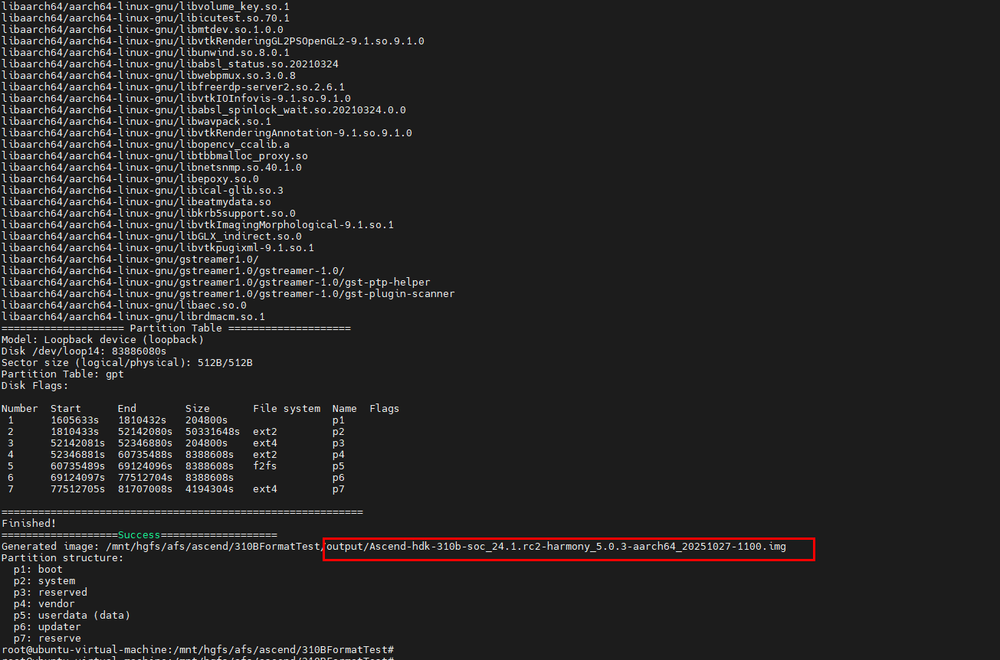
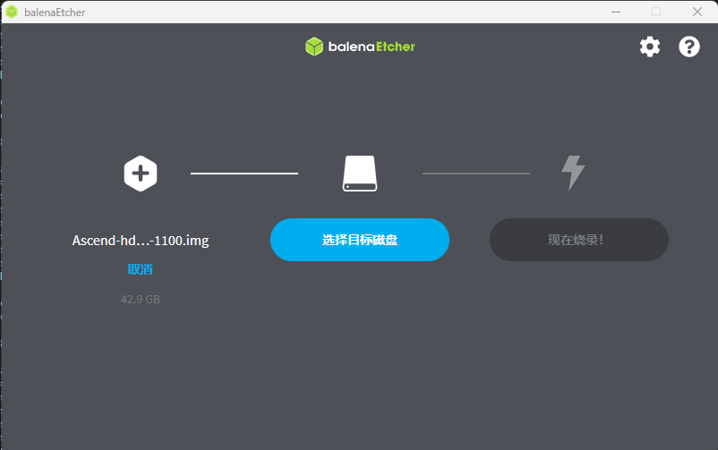
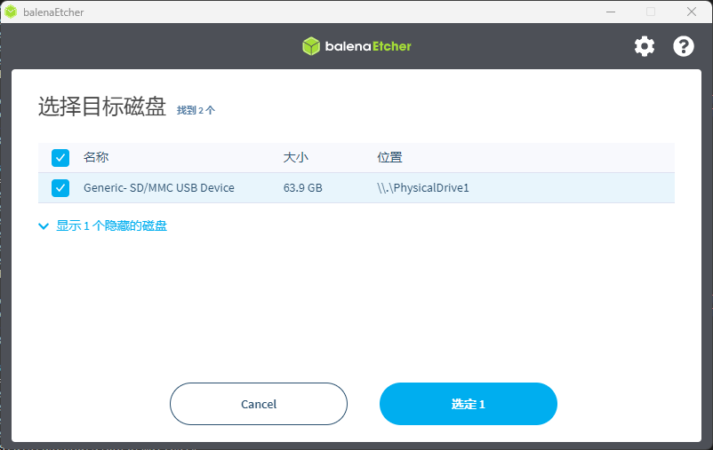

# Ascend 310B OH制卡说明

运行环境Ubuntu 22.04
首次运行，执行以下命令
```
cp tools/library/* /usr/lib64/
chmod 777 tools/emmc-head
```

## 制卡前准备：
将生成的镜像放到ascend-open-harmony-project/device_board_ascend/310BFormatTest/fireware下

## 将镜像制到sd卡：
插上sd卡，fdisk -l查看卡名称
```
fdisk -l
cd ascend-open-harmony-project/device_board_ascend/310BFormatTest
./formatSD310B.sh /dev/sdX
```

## 将镜像制成一个单独的img
为了方便用户在windows制卡，可在linux将镜像制到一个img里，然后放到windows用balenaEtcher工具将卡制到sd卡里
在linux生成img的命令
```
cd ascend-open-harmony-project/device_board_ascend/310BFormatTest
./formatImg310B.sh
```


    执行成功后会在output目录下生成对应的img，然后放到windows，打开balenaEtcher工具选择此img



    选择指到的sd卡



    点击正在烧录进行烧录，烧录完成后即可上板验证

## 单独替换镜像
一次制卡完成后，若只修改了Image、dt.img、vendor.img，可执行firmware下的ddOHImageSd.sh实现单独替换
例如只替换Image:
```
./ddOHImageSd.sh /dev/sdX Image
```