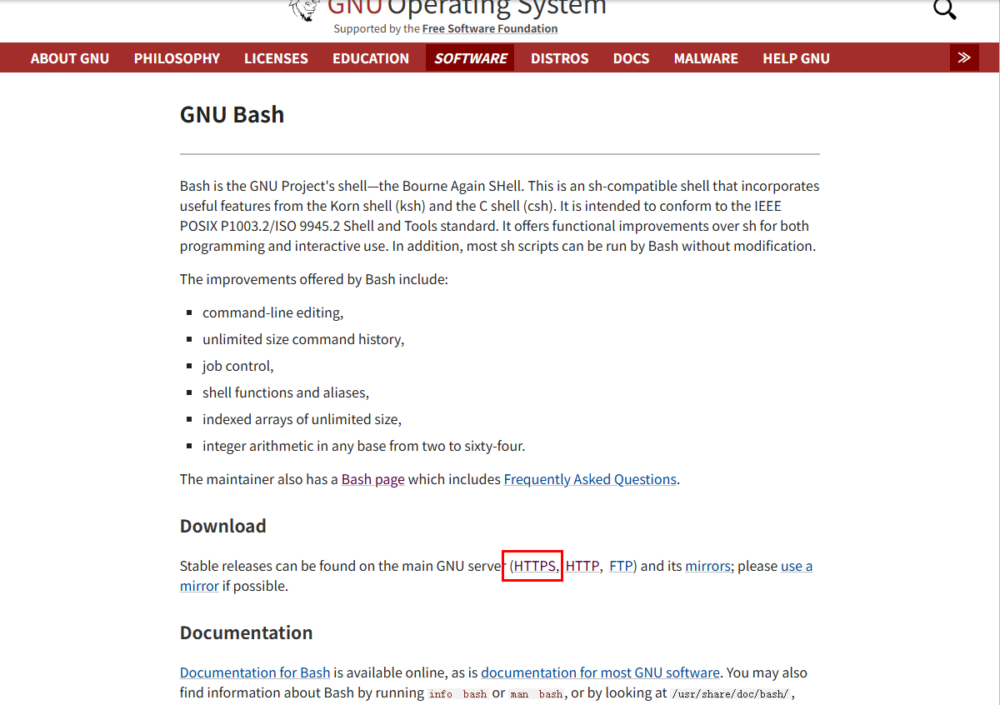
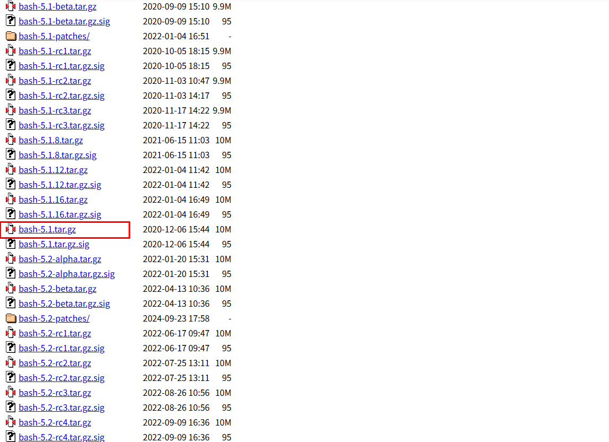
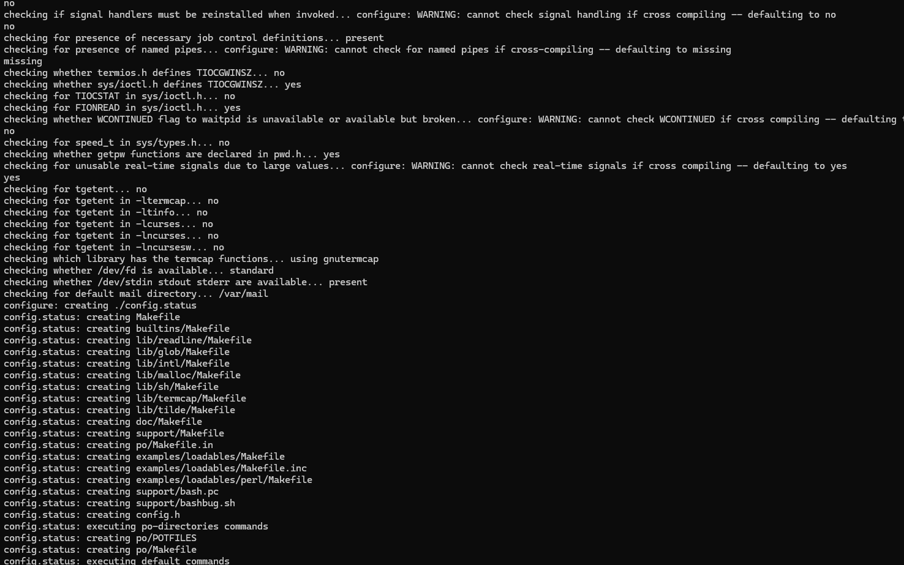
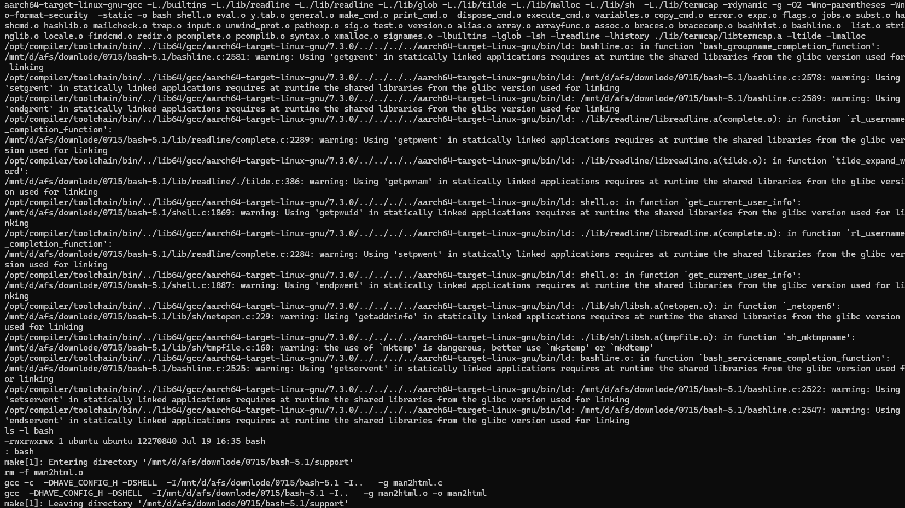
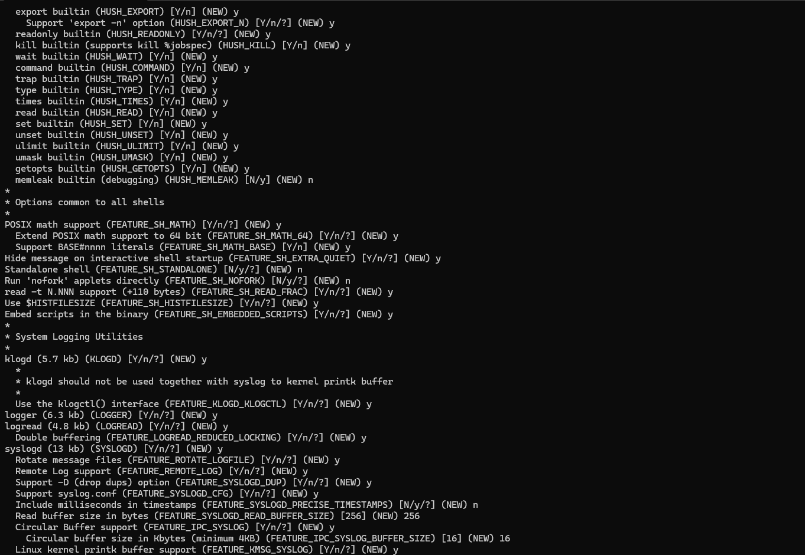
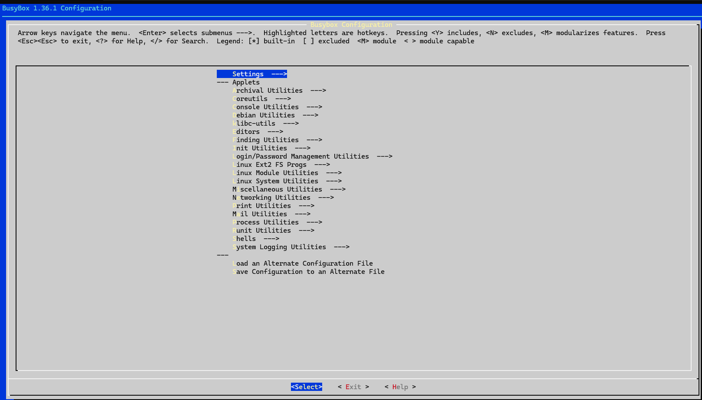
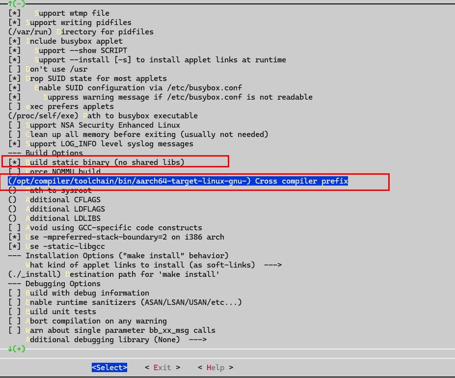
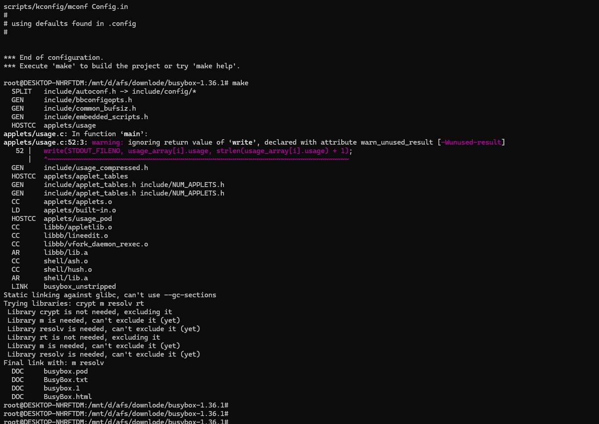
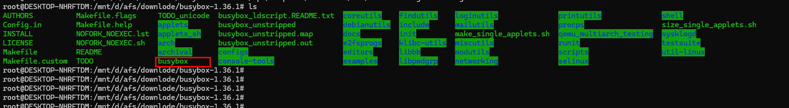

# 移植bash、busybox

## 概述

为了在鸿蒙系统安装Ascend HDK驱动包，需要支持awk、chattr、tr等命令，而鸿蒙自带的toybox不支持awk、chattr、tr等命令，以及部分工具参数有差异，比如grep、ln等，需要移植busybox、bash来支持安装Ascend HDK驱动包。

## 1、移植bash

#### 1）下载源码 https://www.gnu.org/software/bash/bash.html 版本为bash-5.1





#### 2）解压bash-5.1源码，生成makefile并编译，

```
tar -xvf bash-5.1.tar.gz
cd bash-5.1
mkdir installPath
./configure --host=aarch64-target-linux-gnu --target=aarch64-target-linux-gnu --prefix=/opt/bash-5.1/installPath --enable-static-link
make
```





执行以下命令缩小生成的bash
```
aarch64-target-linux-gnu-strip bash
```
缩小后放到工程device_board_ascend/ascend/310B/ascendinstall目录下即可

## 2、移植busybox

#### 1）下载源码 https://busybox.net/downloads/ 版本为busybox-1.36.1

#### 2）安装libncurses5-dev
```
sudo apt-get install libncurses5-dev
```

#### 3）解压busybox-1.36.1源码，设置默认配置、编译编译器并编译，

```
tar -xvf busybox-1.36.1.tar.bz2
cd busybox-1.36.1
make defconfig
```


执行以下命令，进入busybox configuration页面
```
make menuconfig
```


进入Setting界面，设置Build static binary为'y'，设置Cross compiler prefix为编译器实际路径，需要根据实际的编译器路径做修改，这里我的为'/opt/compiler/toolchain/bin/aarch64-target-linux-gnu-'


编译busybox源码
```
make
```


生成的busybox放到工程device_board_ascend/ascend/310B/ascendinstall目录下即可


libaarch64.tar.gz文件下载地址：[文件下载地址](https://pan.baidu.com/s/1MStN-BV0YdoS2XotxhFWFw?pwd=sbr4)