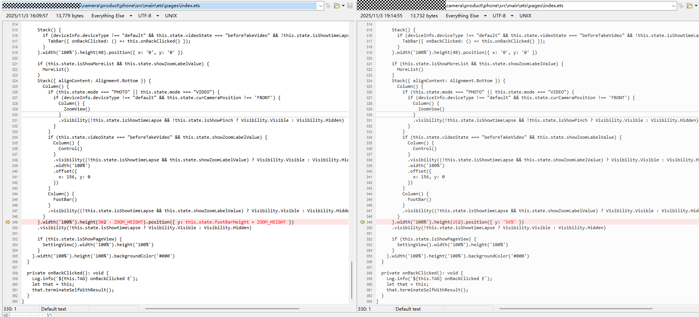
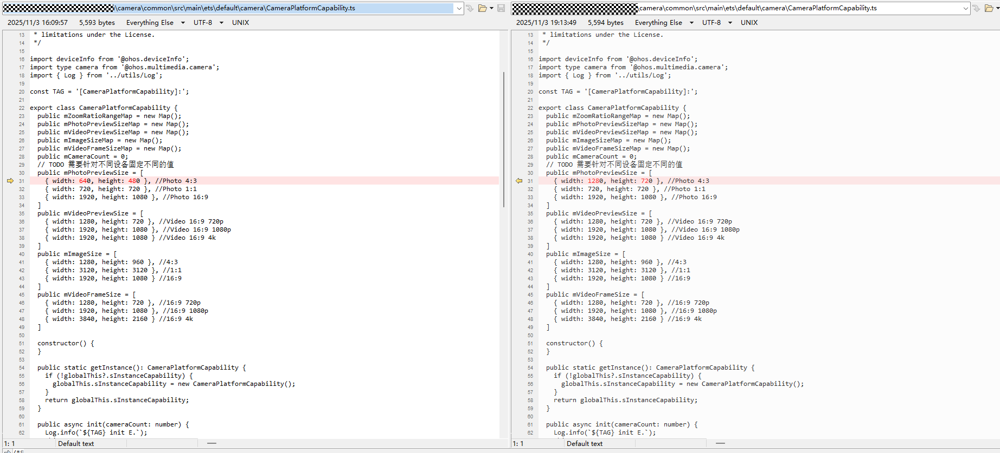
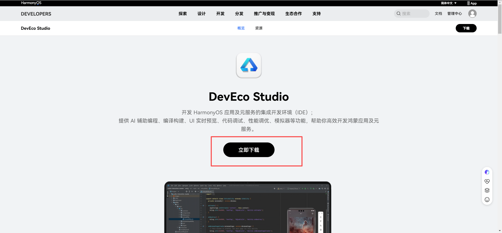
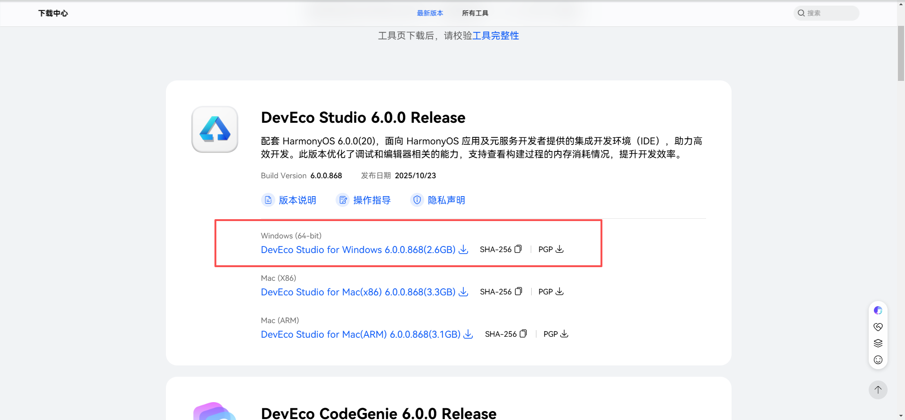
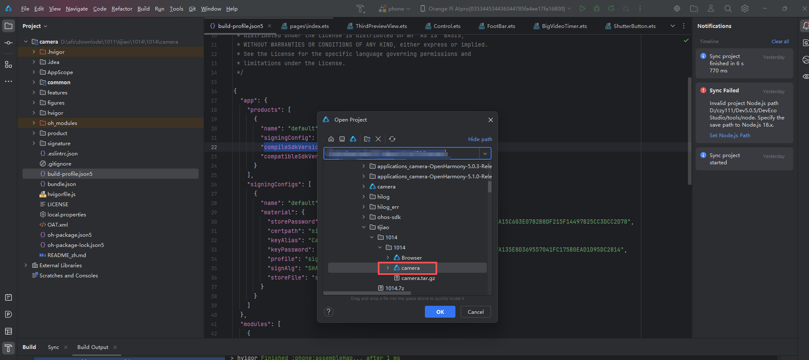
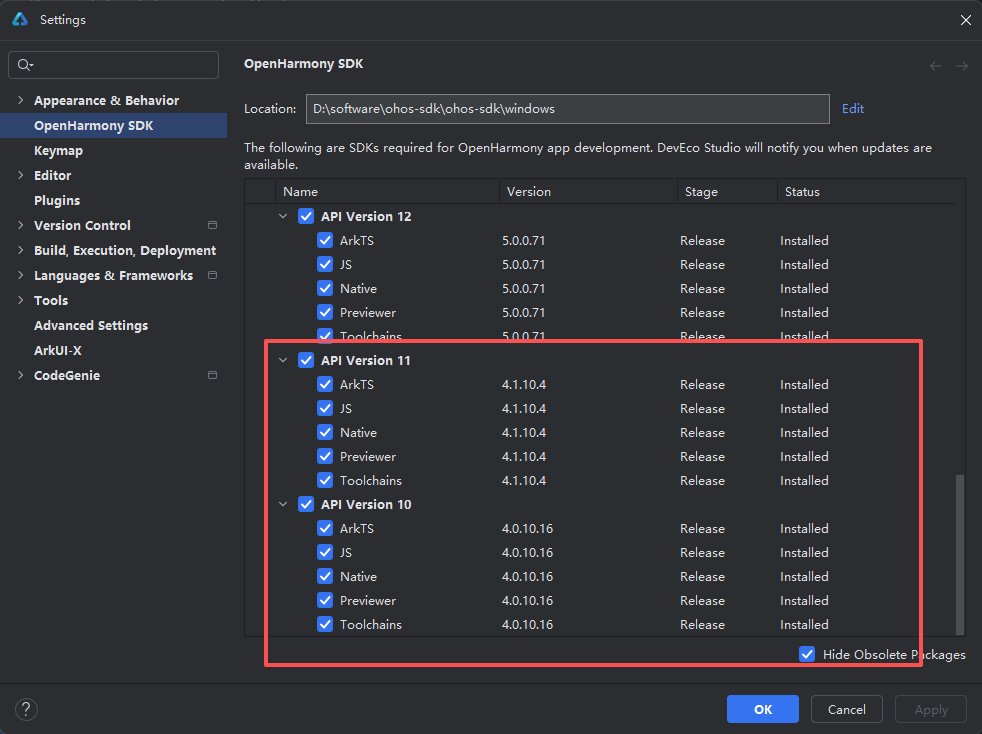
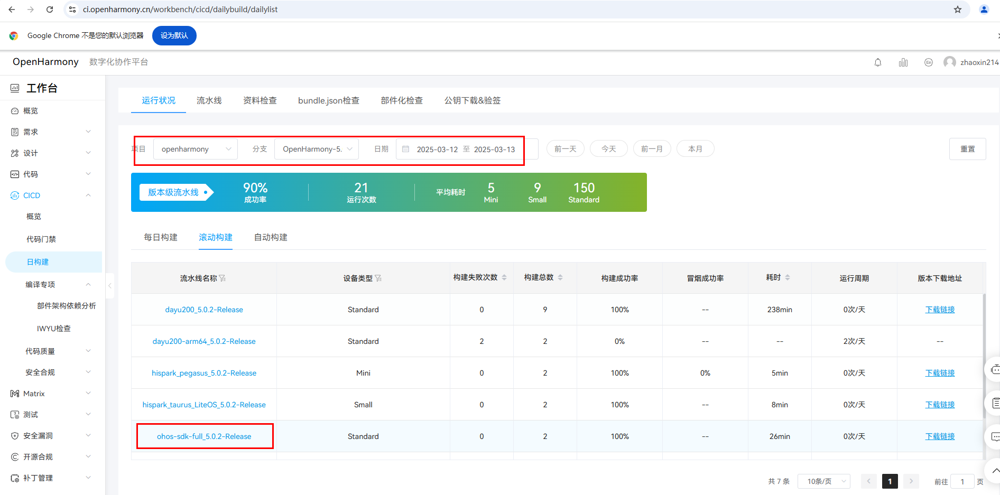
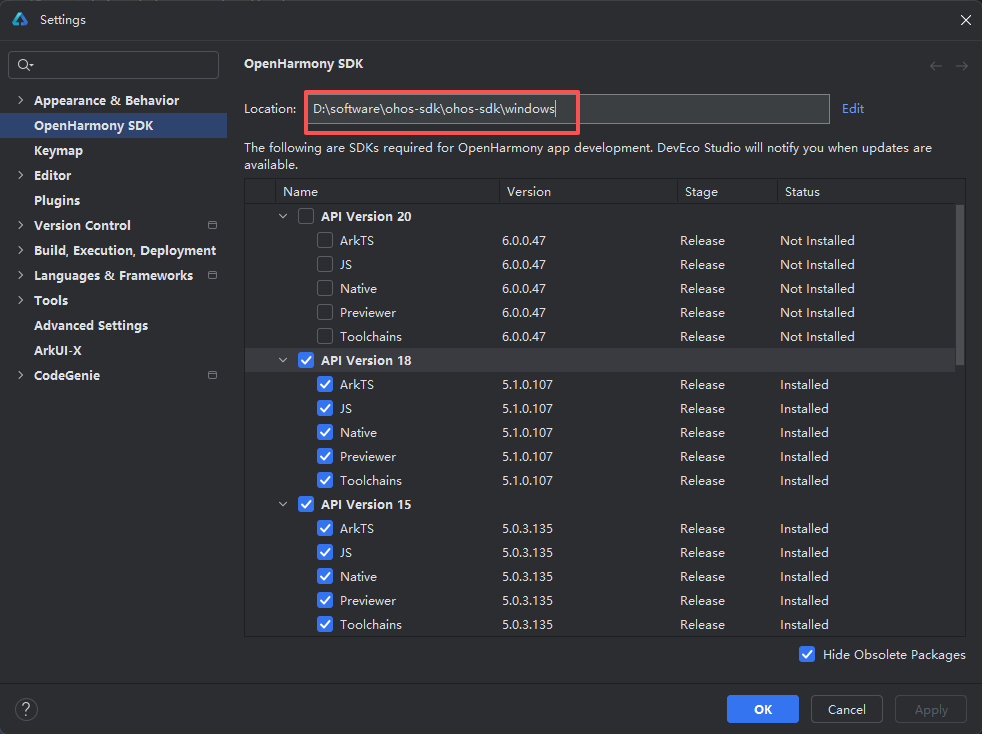
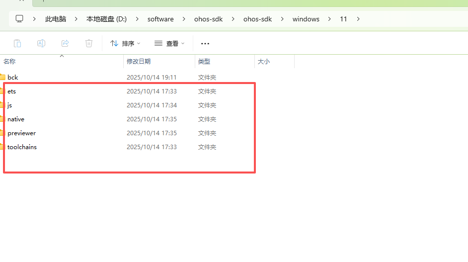
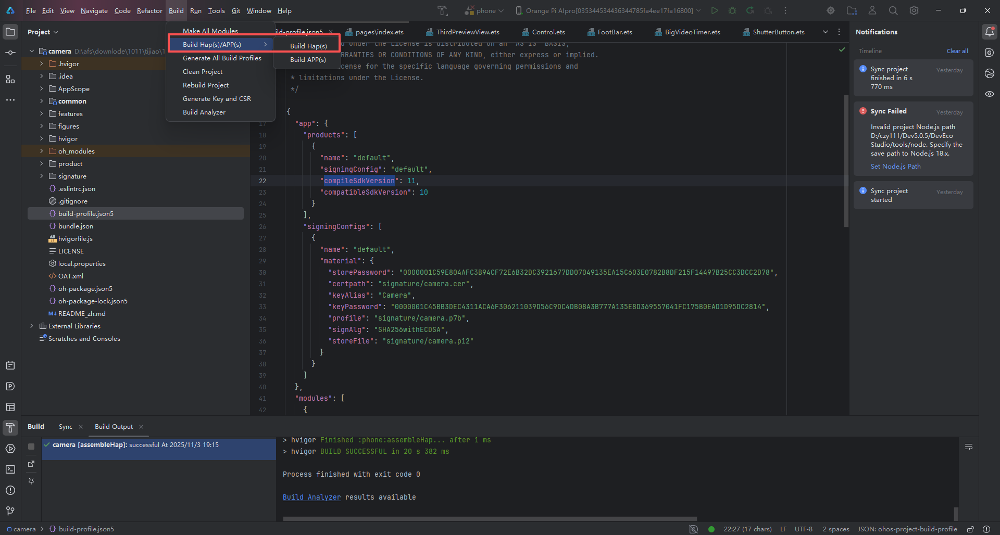

# Camera.hap更新说明

## 1、由于系统自带的 Camera.hap在屏幕显示的时候下方的按钮会不显示，需要修改按钮的位置

## 2、目前将拍照分辨率设置为1280 * 720，需要修改预览的默认配置也为1280 * 720

# Camera.hap编译说明

## 1、安装deveco-studio软件
    https://developer.huawei.com/consumer/cn/deveco-studio/

    选择最新版本

## 3、解压camera.tar.gz并用deveco-studio打开camera工程
file->open，选择解压后的工程

file->setting，下载api10和11到指定路径

## 2、更新OpenHarmony-5.0.2-Release的sdk，编译生成hap
下载sdk包，注意选择日期为2025.3.12

sdk_switch
解压sdk包，将里面的内容替换至deveco-studio软件包里默认的sdk

