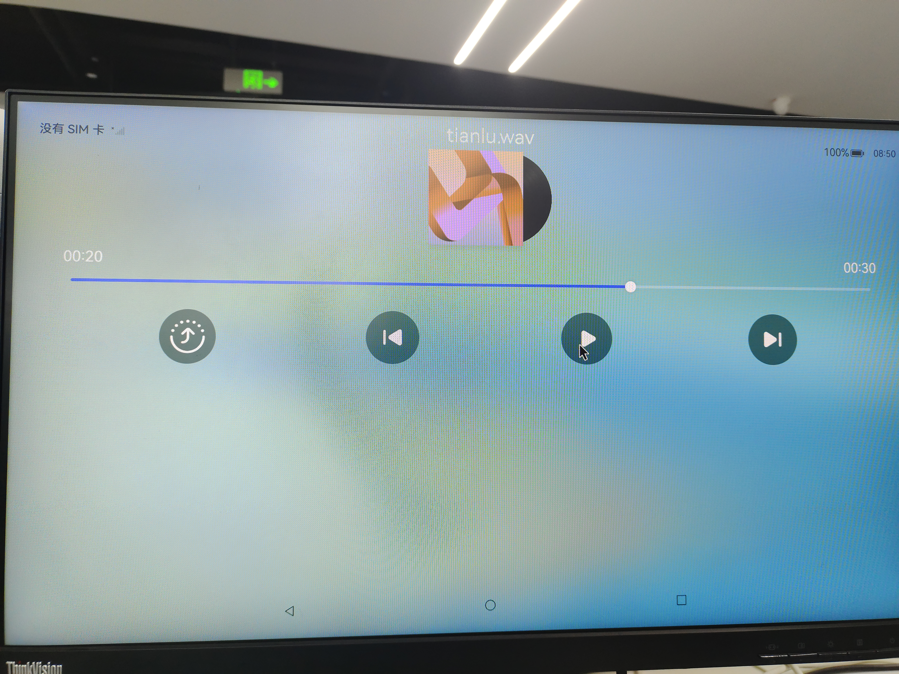
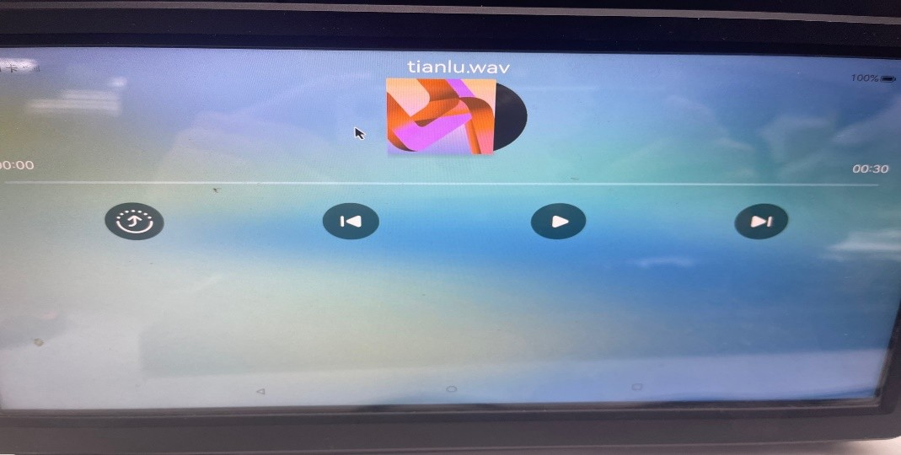

# Ascend 310B 音频功能测试说明

## 测试耳机播放
    测试前将耳机插到板子上

```
service_control stop audio_server
amixer set Playback 10        --设置播放音量
amixer set Deviceid 2         --设置使用耳机
service_control start audio_server
```
    打开音乐app，点击播放，正常会在耳机听到声音


## 测试hdmi播放
    测试前将带hdmi音频功能的显示器插到板子hdmi0
    
```
service_control stop audio_server
amixer set Deviceid 3        --设置使用hdmi0，若测试hdmi1，Deviceid设置为4
service_control start audio_server
```
    打开音乐app，点击播放，正常会在hdmi显示器听到声音


## 测试arecord录音

    将带有麦克风的耳机插到设备上，执行以下命令开始录音，这里的-d后面的参数代表录多长时间，单位秒
    由于服务audio_server已经占用alsa驱动，测试时需要关闭audio_server。

```
service_control stop audio_server
amixer set Capture 10       --设置录音音量
arecord -D plughw:0,1 -f S16_LE -r 48000 -t raw -d 10 1.pcm
service_control start audio_server
```

## 测试apply播放

    因为适配了alsa框架，所以也能直接通过aplay指令来播放音乐。
    由于服务audio_server已经占用alsa驱动，测试时需要关闭audio_server。

```
service_control stop audio_server
aplay -Dhw:ascend310b -f S16_LE -r 48000 -t raw 1.pcm
service_control start audio_server
```

## USB音频
参考：https://www.hiascend.com/forum/thread-0254119620915962057-1-1.html 
    录音

```
-c 声道
-r 采样率
-f 格式
arecord -D plughw::1,0 -c 1 -r 48000 -f S16_LE test.wav

arecord -D plughw:1,0 -c 1 -r 16000 -f S16_LE test.wav

aplay -D plughw:1,0 test.wav
播放：

```

    先用aplay -l 查看USB音频对应的设备号，一般在1之后，0是内置的alsa设备

```
aplay -Dhw:1 /system/etc/tianlu.wav

或者如下：录音的必须用plughw进行播放
aplay -D plughw:1,0 /system/etc/tianlu.wav

```