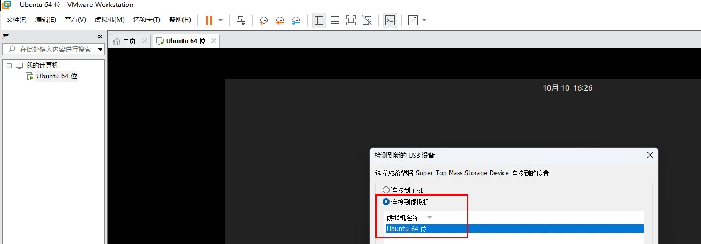
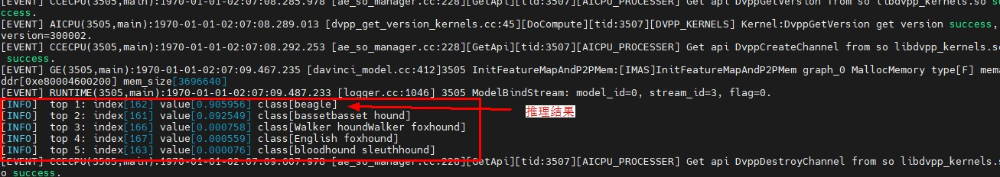

# CANN推理环境搭建及推理demo验证

## 概述

在此之前，完成了310B鸿蒙系统的移植，以及制卡和驱动的适配。此时设备已能正常运行鸿蒙系统，串口功能正常，CANN HDK驱动等已正常加载。
本文档指导用户基于当前设备状态，完成NNRT包的安装、推理运行环境的配置、推理demo的运行。

主要包含如下几部分：
#### 1）基础包及文件准备：包括CANN包、推理模型、推理demo程序的导入；
#### 2）环境初始化；
#### 3）安装CANN NNRT包；
#### 4）推理模型验证。

基础包：
#### 1）cann-install.zip (寻找开发人员获取)
#### 2） Ascend-cann-nnrt_7.0.0_linux-aarch64.run通过昇腾官网下载：https://support.huawei.com/enterprise/zh/software/258923273-ESW2000957399

## 1、cann-install.zip基础包准备
#### 1）将设备sd卡接入虚拟机


#### 2）查看设备sd卡的磁盘信息‌
```
fdisk –l
```

#### 3）创建挂载目录
```
mkdir test
```

#### 4）将sd卡与文件挂载
```
mount -o rw /dev/sdX test
```

#### 5）解压cann-install.zip到sd卡
```
unzip cann-install.zip -d test
sync
```

#### 6）解挂载
```
umount test
```

## 2、初始化环境

主要包括：
#### 1）手动将根文件系统mount成可读写（因鸿蒙系统默认根文件系统为只读）;
#### 2）CANN包安装需要的系统命令准备(包括：awk, mkdir, grep, tr, sha256sum, expr)，基于busybox建立相关软链接;
前面两个步骤已封装在initmodel.sh脚本中，执行如下命令即可；
```
cd /cann-install/
chmod 777 *.sh
bash initmodel.sh
```
initmodel.sh执行失败时，屏蔽调第一行的/var/dmp_daemon命令

## 3、安装NNRT包

因为系统中ln不支持-r参数，NNRT包中shell脚本需要做相应适配，当前CANN包未做对应修改，所以手动解压后，修改脚本，分步骤来安装。步骤如下：

#### 1）手动安装子包runtime
```
cd /cann-install/nnrt/run_package/runtime
./runtime/scripts/install.sh -- -- --full
```

#### 2）手动安装子包pyacl
```
cd /cann-install/nnrt/run_package/pyacl
./script/install.sh -- -- --full
```

#### 3）手动安装子包test
```
cd /cann-install/nnrt/run_package/test
./script/install.sh -- -- --full --install-path=/usr/local/Ascend/
```

#### 4）手动安装子包aicpu
```
cd /cann-install/nnrt/run_package/aicpu
./aicpu/script/install.sh -- -- --full
```
根据提示按y进一步安装

#### 5）手动安装子包aicpu310
```
cd /cann-install/nnrt/run_package/aicpu310
./aicpu/script/install.sh -- -- --full
```
根据提示按y进一步安装

#### 6）手动安装子包aicpu310mini
```
cd /cann-install/nnrt/run_package/aicpu310mini
./aicpu/script/install.sh -- -- --full
```
根据提示按y进一步安装

#### 7）手动安装子包aicpu310p
```
cd /cann-install/nnrt/run_package/aicpu310p
./aicpu/script/install.sh -- -- --full
```
根据提示按y进一步安装

## 4、推理demo运行
推理模型运行脚本主要包括几部分功能：
#### 1）CANN环境变量配置；
#### 2）权限修改，启动模型sample；
相关功能封装在脚本runmodel.sh中。执行命令如下：
```
cd /cann-install/
bash runmodel.sh
```

执行结果如下：

可以看出推理分类为beagle的概率为0.905956。

## 5、运行大模型安装Python包
```
cp -r /cann-install/Python /usr/local/
source /usr/local/Python/set_python_env.sh
cd /usr/local/Python/bin
python3.10 -m ensurepip --upgrade
pip3 --version
```

## 6、运行大模型安装toolkit包
因为系统中ln不支持-r参数，NNRT包中shell脚本需要做相应适配，当前CANN包未做对应修改，所以手动解压后，修改脚本，分步骤来安装。步骤如下：
#### 1）手动安装子包toolkit
```
cd /cann-install/toolkit/run_package/toolkit
./toolkit/scripts/install.sh -- -- --full
```

#### 2）手动安装子包runtime
```
cd /cann-install/toolkit/run_package/runtime
./runtime/scripts/install.sh -- -- --full
```
根据提示按y进一步安装

#### 3）手动安装子包opp
```
cd /cann-install/toolkit/run_package/opp
./opp/script/install.sh -- -- --full
```
根据提示按y进一步安装

#### 4）手动安装子包ncs
```
cd /cann-install/toolkit/run_package/ncs
./ncs/script/install.sh -- -- --full
```

#### 5）手动安装子包compiler
```
cd /cann-install/toolkit/run_package/compiler
./compiler/scripts/install.sh -- -- --full
```

#### 6）手动安装子包aoe
```
cd /cann-install/toolkit/run_package/aoe
./aoe/script/install.sh -- -- --full
```

#### 7）手动安装子包pyacl
```
cd /cann-install/toolkit/run_package/pyacl
./script/install.sh -- -- --full
```

#### 8）手动安装子包test
```
cd /cann-install/toolkit/run_package/test
./script/install.sh -- -- --full --install-path=/usr/local/Ascend/
```

## 7、安装大模型kernels包
```
cd /cann-install/kernels/run_package/opp_kernel
./scripts/install.sh -- -- --full
```

## 8、运行大模型安装推理离线包
```
cd /cann-install/python_packs
pip3 install attrs-24.2.0-py3-none-any.whl
pip3 install PyYAML-6.0.2-cp310-cp310-manylinux_2_17_aarch64.manylinux2014_aarch64.whl
pip3 install wheel-0.44.0-py3-none-any.whl
pip3 install psutil-6.1.0-cp36-abi3-manylinux_2_17_aarch64.manylinux2014_aarch64.whl
pip3 install numpy-1.24.0-cp310-cp310-manylinux_2_17_aarch64.manylinux2014_aarch64.whl
pip3 install decorator-5.1.1-py3-none-any.whl
pip3 install mpmath-1.3.0-py3-none-any.whl
pip3 install sympy-1.13.3-py3-none-any.whl
pip3 install scipy-1.14.1-cp310-cp310-manylinux_2_17_aarch64.manylinux2014_aarch64.whl
pip3 install protobuf-3.20.0-cp310-cp310-manylinux2014_aarch64.whl
pip3 install gnureadline-8.2.13-cp310-cp310-manylinux_2_17_aarch64.manylinux2014_aarch64.whl
pip3 install MarkupSafe-3.0.2-cp310-cp310-manylinux_2_17_aarch64.manylinux2014_aarch64.whl
pip3 install jinja2-3.1.4-py3-none-any.whl
pip3 install typing_extensions-4.12.2-py3-none-any.whl
pip3 install networkx-3.4.2-py3-none-any.whl
pip3 install filelock-3.16.1-py3-none-any.whl
pip3 install fsspec-2024.10.0-py3-none-any.whl
pip3 install torch-2.3.1-cp310-cp310-manylinux_2_17_aarch64.manylinux2014_aarch64.whl 
pip3 install torch_npu-2.3.1-cp310-cp310-manylinux_2_17_aarch64.manylinux2014_aarch64.whl
pip3 install pillow-11.0.0-cp310-cp310-manylinux_2_28_aarch64.whl
pip3 install torchvision-0.18.1-cp310-cp310-manylinux2014_aarch64.whl
```
期间有没安装上的whl等安装完成，重新执行下pip3 install xxx.whl