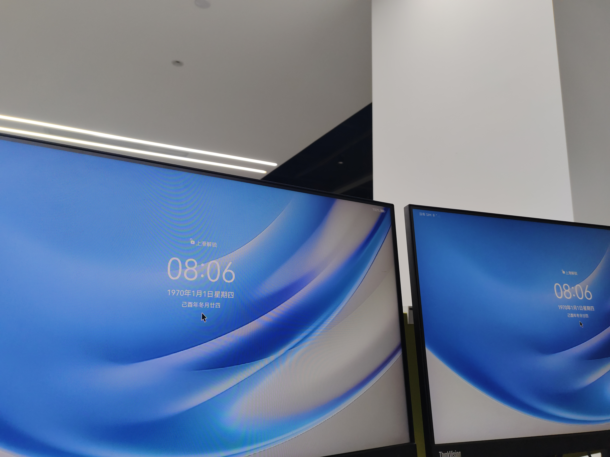
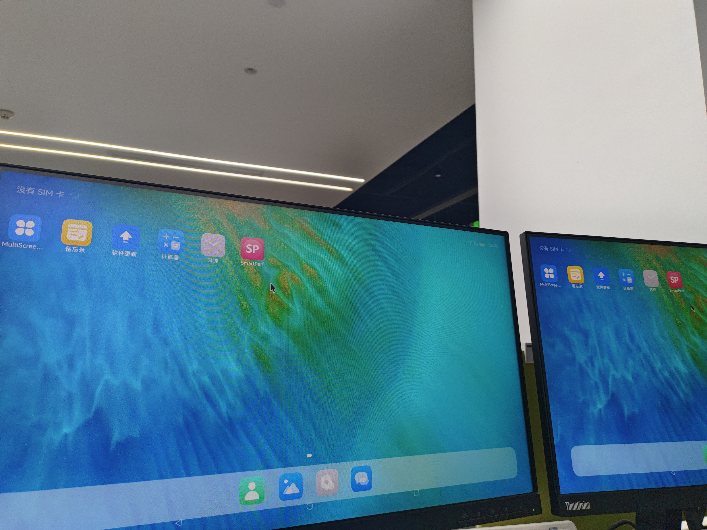
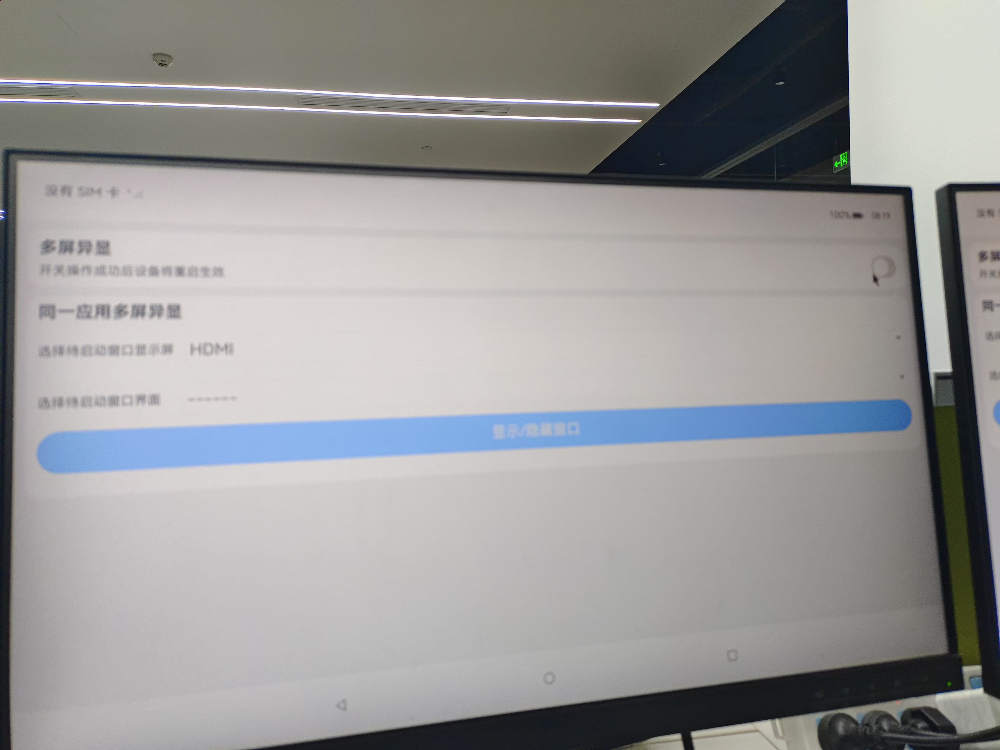
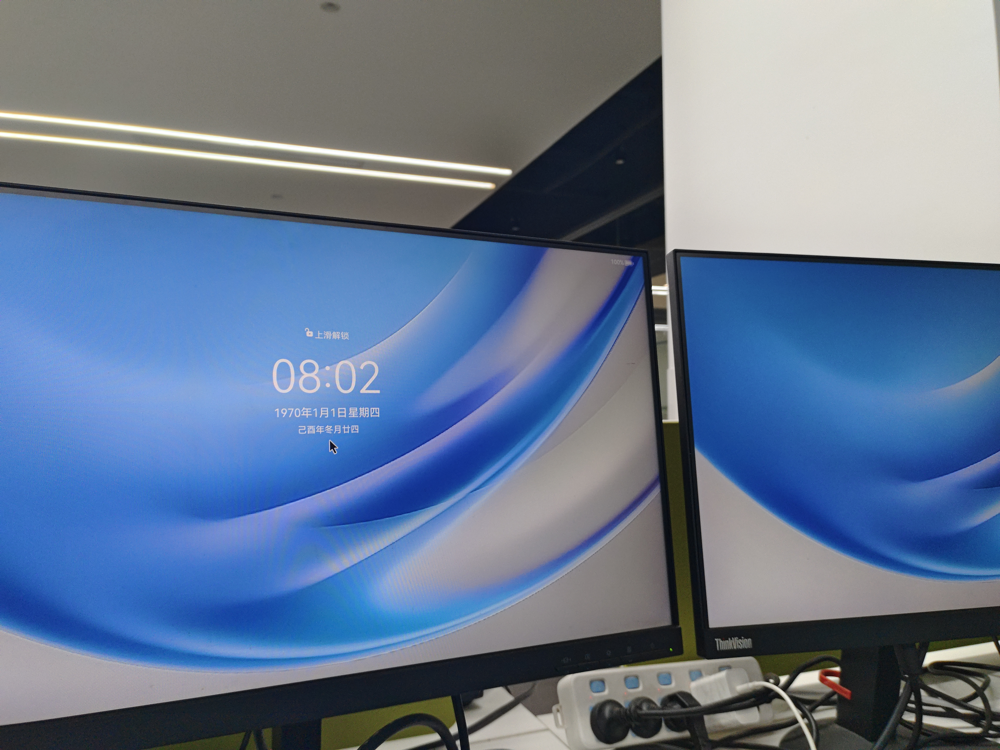
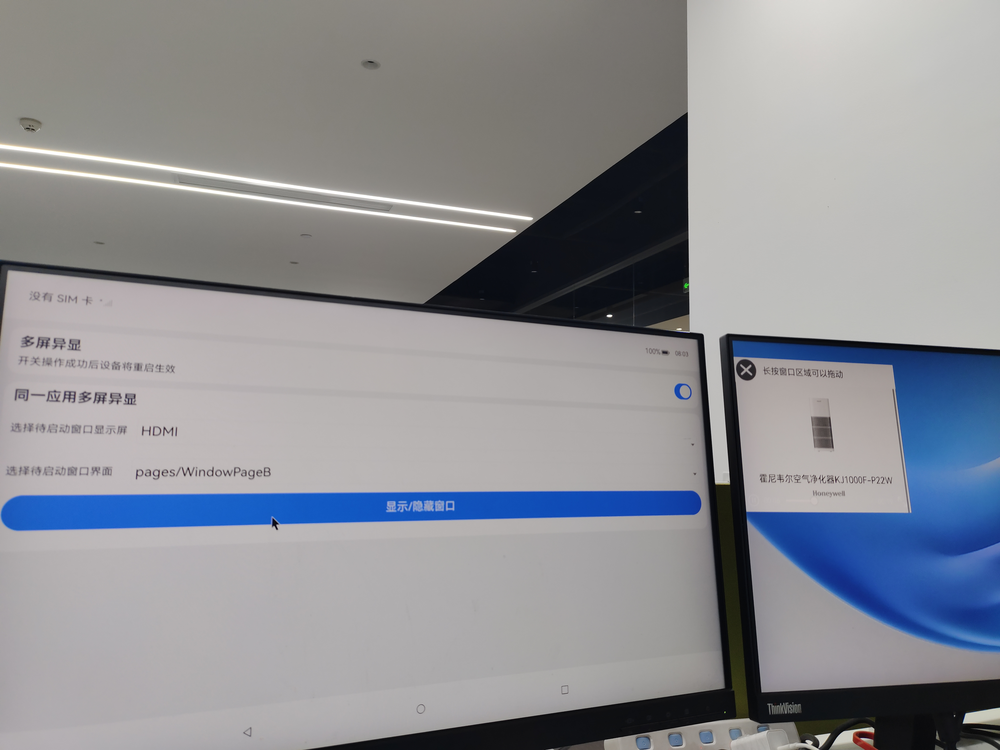
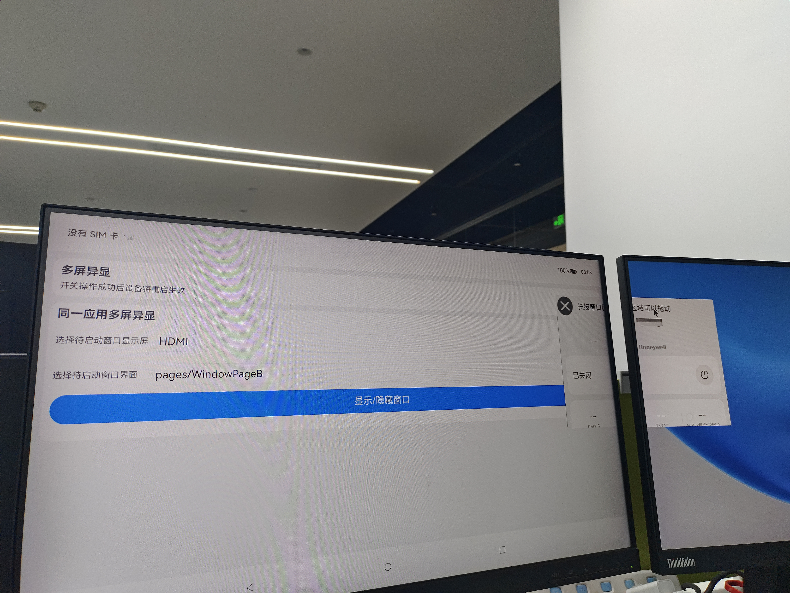
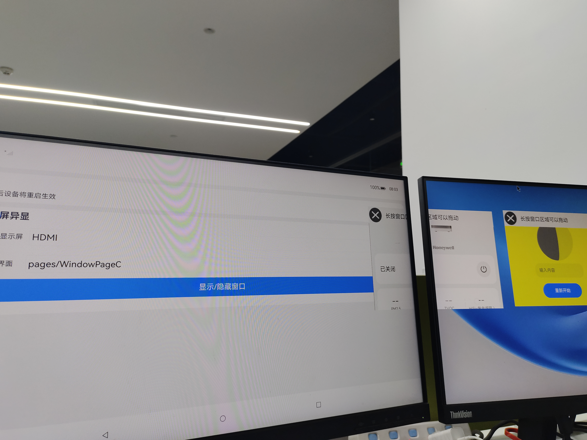

# Ascend 310B 多屏功能测试说明

进行测试之前，将设备的两个hdmi接口均接上显示器

## 多屏同显

设备默认是多屏同显功能，可以看到设备接的两个屏幕是一样的输出



## 多屏异显

## 1、安装多屏功能测试app

将ascend-open-harmony-project项目中device_board_ascend/tools/test_multiscreen/multiscreendisplaydemo.hap安装到设备上
windows侧未安装hdc请参考[OpenHarmony命令行工具hdc安装应用指南](https://developer.huawei.com/consumer/cn/blog/topic/03137966529669104)

```
hdc install device_board_ascend/tests/multiscreen/multiscreendisplaydemo.hap
```

## 2、进入多屏功能测试app，打开多屏异显测试开关，打开后设备会自动重启



## 3、滑动鼠标，可以看到鼠标可以在两个屏幕来回切换


## 4、进入多屏功能测试app，选择对应的屏幕，点击显示/隐藏，可以看到对应的小窗口显示/隐藏





移动小窗口在两个屏幕间来回切换

